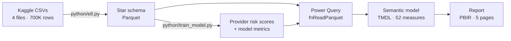
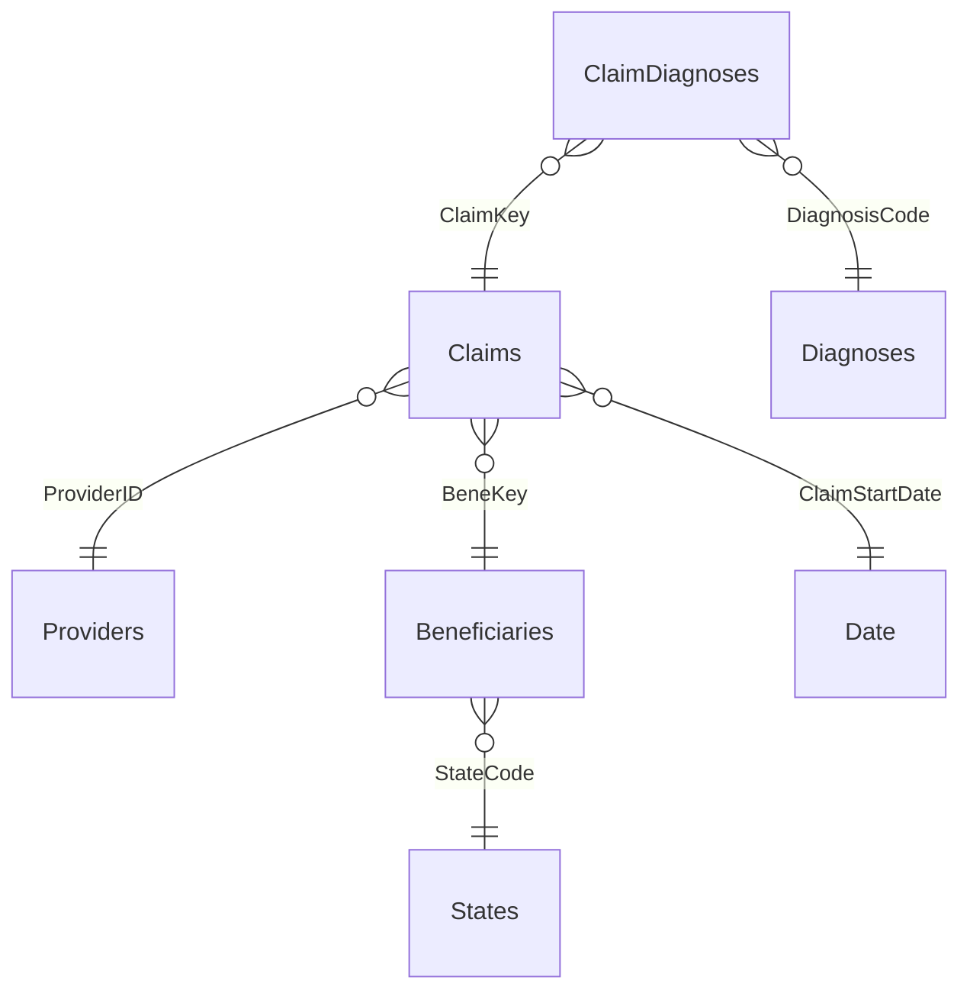

# Healthcare Provider Fraud Analytics — Power BI

An end-to-end analytics project on **558K Medicare claims from 5,410 providers**. It covers a Python ETL to a star schema, a
machine-learning fraud-risk score, and a **5-page Power BI report** built as a source-controlled Power BI Project (PBIP / TMDL / PBIR).


> **Business question:** Medicare loses billions to provider fraud every year, and investigators can only review a fraction of
> providers. *Where is fraud-linked money concentrated, what do suspicious providers look like, and which providers
> should be reviewed first?*

---

## Key findings

| | |
|---|---|
| **9% of providers, 53% of spend** | The 506 providers labelled *potential fraud* bill 38% of all claims and **$296M of $557M** reimbursed. |
| **Scale, not price** | A flagged provider's average claim costs **84% more**, but within each claim type the cost is nearly identical ($10.3K vs $9.8K inpatient). The gap comes from mix: flagged providers have a **2.2x higher inpatient share** (11.0% vs 4.9% of claims), and the median flagged provider serves **4–5x more patients, physicians and states**. |
| **Spend is concentrated** | The top 10% of providers receive **65%** of all reimbursement. |
| **The model prioritises well** | Out-of-fold ROC AUC **0.935**. Reviewing only the riskiest 10% of providers finds **64% of flagged providers** and **89% of their reimbursement**. That decile's fraud rate is **6.4x** the 9.4% base rate. |


---

## Dashboard

An interactive HTML version of the analysis, [`docs/dashboard.html`](docs/dashboard.html), runs in any browser with no install.
It has hover tooltips and supports light and dark mode. All of its data is embedded, built from `data/processed/` by `docs/build_dashboard.py`.


> To serve it as a live page, enable **GitHub Pages** (Settings → Pages → deploy from `main`, folder `/`).
> It will then be at `https://<your-username>.github.io/healthcare-fraud-powerbi/docs/dashboard.html`.

---

## Report pages

| Page | What it answers | Highlights |
|---|---|---|
| **1. Executive Overview** | How much is spent, and how much goes to flagged providers? | 6 KPI cards · metric-selector trend (dynamic measure + dynamic format string + dynamic title) · spend by state and diagnosis chapter |
| **2. Provider Risk** | Which providers should investigators look at first? | Risk-tier scatter · Top-N what-if parameter · watch-list table with gradient and measure-driven conditional formatting |
| **3. Claims & Utilization** | Where are cost and billing red flags? | Time-intelligence **calculation group** matrix (Prior Month, MoM %, Rolling 3M, YTD) · provider Pareto curve · same-day duplicate billing |
| **4. Patient Demographics** | Who is being billed for? | Age, chronic-condition burden, gender, race and state. Patient measures use `CROSSFILTER` so they react to provider filters |
| **5. Model Insights** | Can we trust the score? | Permutation feature importance · precision/recall threshold curve · decile lift chart · evaluation metrics |


---

## Architecture



### Data model (star schema)



| Table | Rows | Grain / purpose |
|---|---:|---|
| `Claims` | 558,211 | Fact: one row per inpatient or outpatient claim |
| `Claim Diagnoses` | 1,680,716 | Bridge: one row per diagnosis code on a claim (positions 1–10) |
| `Providers` | 5,410 | Dimension: fraud label, 19 engineered features, model score, risk tier and decile |
| `Beneficiaries` | 138,556 | Dimension: age band, gender, race, 11 chronic-condition flags |
| `Diagnoses` | 11,014 | Dimension: ICD-9 code mapped to 3-digit category and chapter |
| `States` | 52 | Dimension: SSA state codes mapped to names (CMS DE-SynPUF codebook) |
| `Date` | DAX | Calendar generated from the claim date range and marked as the date table |
| `Time Intelligence` | — | Calculation group |
| `Metric Selector`, `Top N` | — | Disconnected parameter tables |
| `Model *` (3 tables) | — | Feature importance, evaluation metrics and threshold curve from the Python model |

---

## Techniques demonstrated

**Power BI and DAX**

- Power BI Project (**PBIP**) with a **TMDL** semantic model and **PBIR** report. Every measure, relationship and visual is diff-able in Git.
- **Calculation group** for time intelligence, with a dynamic format string on `MoM %`.
- **Dynamic measure selection** (`SWITCH` and a disconnected table) with `formatStringDefinition` and a measure-driven visual title.
- **What-if parameter** (`GENERATESERIES`) driving a `RANKX` / `ALLSELECTED` Top-N.
- **Bridge table** for many-to-many diagnoses, filtered on demand with `CROSSFILTER(..., BOTH)` rather than a bidirectional relationship.
- `KEEPFILTERS` in all filtered measures, so slicers on the same column still apply.
- Risk-weighted exposure via `SUMX` with context transition. Pareto curve and top-decile share via `TOPN`.
- Conditional formatting: gradient fill rule plus a measure that returns hex colours.
- **Row-level security** example role (`Regional Analyst (California)`).
- Custom report theme with a colour-blind-checked palette. Parameterised data source that reads local files **or a URL**.

**Python**

- Reproducible ETL with referential-integrity assertions. Red-flag feature engineering (same-day duplicate billing, inpatient share, claims per physician, states served).
- `HistGradientBoostingClassifier` with **5-fold stratified out-of-fold scoring**, so no provider is scored by a model that saw its label. Platt calibration, permutation importance, and threshold analysis.


---

## Repository structure

```
healthcare-fraud-powerbi/
├── powerbi/
│   ├── HealthcareFraudAnalytics.pbip              ← open this in Power BI Desktop
│   ├── HealthcareFraudAnalytics.pbix              ← same report as one file (saved from Desktop)
│   ├── HealthcareFraudAnalytics.SemanticModel/    ← TMDL: tables, measures, relationships, RLS role
│   └── HealthcareFraudAnalytics.Report/           ← PBIR: pages, visuals, custom theme
├── python/
│   ├── etl.py                                     ← raw CSV → star-schema Parquet
│   └── train_model.py                             ← provider fraud-risk model
├── notebooks/01_eda.ipynb                         ← exploratory analysis (executed, with outputs)
├── data/
│   ├── raw/                                       ← Kaggle CSVs (git-ignored; see README inside)
│   └── processed/                                 ← Parquet tables used by Power BI (committed)
└── docs/
    ├── dashboard.html                             ← interactive dashboard (open in a browser)
    ├── build_dashboard.py                         ← rebuilds dashboard.html from the Parquet data
    ├── dax_measures.md                            ← measure catalog
    ├── images/                                    ← charts used in this README
    └── screenshots/                               ← report page screenshots
```

---


---

## Model performance (out-of-fold, 5,410 providers)

| Metric | Value |
|---|---:|
| ROC AUC | 0.935 |
| PR AUC (average precision) | 0.685 (base rate 0.094) |
| Precision / recall at 0.5 | 71.6% / 46.2% |
| Precision in top 10% riskiest | 59.5% |
| Flagged providers caught in top 10% | 63.6% |
| Flagged-provider $ caught in top 10% | 89.3% |


Total reimbursement dominates the feature importance. That is expected for this dataset, since the labels are strongly linked
to provider size. A production version would test for size bias and add peer-group normalisation (for example, cost per claim
versus providers with a similar case mix).

---
